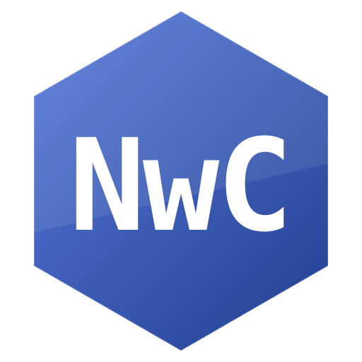

```text
  _   _           ____   _____ 
 | \ | |         / __ \ / ____|
 |  \| |_      _| |  | | (___  
 | . ` \ \ /\ / / |  | |\___ \ 
 | |\  |\ V  V /| |__| |____) |
 |_| \_| \_/\_/  \____/|_____/ 
```
# NwOS


A small x86 operating system written in C and NASM.
(Unsupports real hardware, use qemu)

## Features

- VGA text mode
- PS/2 keyboard
- Command shell
- Calculator
- Command history
- Games
- Colors
- Time
- Automatic terminal scrolling
- Save files (disk)
- Kernel panic Safe/Fatal
- Compiler
- Network

## ⚠️ Official Developer Account Update

I lost access to my previous GitHub account due to 2FA recovery issues.

This is my new official account. I am the original developer of **NwOS** and **NwC**. My username has changed slightly, but the projects are still mine.

All future updates and development will continue here.

Thank you for your understanding and support!

**New official profile:** https://github.com/User0140155

**Old profile (if you need archives of <v1.4.6):** https://github.com/User014015/

## Tiktok page
(Russian account)

https://www.tiktok.com/@csplayer421

## Compiler

to compile File you need:

learn NwC (tutorial file: NWCTutorial)

## Games
- 1.Guess Number
- 2.Word Game
- 3.Rock Paper Scissors
- 4.Coin Flip
- 5.Dice
- 6.Higher / Lower
- 7.Math Quiz
- 8.Hangman
- 9.Tic Tac Toe

## Build and run

download iso from releases,
or use this:
```bash
git clone https://github.com/User0140155/NwOS/
bash disk
bash build.sh
bash run.sh
```

Then run:
```bash
qemu-system-x86_64 \
    -boot d \
    -cdrom NwOS.iso
    -m 128M \
    -nic user,model=e1000 \
    -drive file=disk.img,format=raw,if=ide,index=0 \
    -display sdl,grab-mod=rctrl
```

(Before this, make sure that you has a disk)

```bash
qemu-img create -f raw disk.img 50M
```

## Compilers to build

clang, nasm, ld, linux (for .sh), nwc (optional)

## Run

Run,

type command help for help

## Security notice

NwOS is a **hobby operating system**. It is **not designed for production use**.

Network stack:
- No firewall
- No rate limiting
- No IPv6
- Basic IPv4 only (ARP, ICMP, UDP, DNS)

**Do not expose NwOS to untrusted networks.** Use only in QEMU or isolated lab environments.

## NwC

Nwc - its a compiler that works in NwOS


